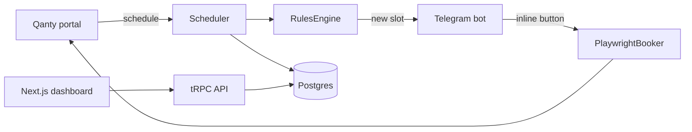

# SMS Onboarding Guide

> Read this before the README if you are new to the repository. It explains what the system does, the vocabulary, and how the pieces fit together.

---

## 1. What SMS does

SMS monitors the Qanty medicine-dispensing portal, applies three deterministic rules, sends a Telegram alert with one button per family member, and opens a headless browser to fill the booking form when a human taps a button.

| Piece | Plain-language role |
| --- | --- |
| Scheduler | The guard that watches the hospital portal |
| Qanty | The hospital portal |
| RulesEngine | The checklist that decides whether a slot is actionable |
| Telegram bot | The phone that rings with one button per person |
| PlaywrightBooker | The robot hands that fill the form |
| Postgres | The filing cabinet for profiles and appointments |
| tRPC API | The intercom between the dashboard and the filing cabinet |
| Next.js dashboard | The control panel in the browser |
| ODD | The logbook that records how each change is built |

The project has three runtimes:

| App | Runtime | Responsibility |
| --- | --- | --- |
| `apps/scheduler` | Node + TSX | Polling, rules, Telegram, Playwright |
| `apps/server` | Bun + Express | Authentication and tRPC API |
| `apps/web` | Next.js 16 + React 19 | Dashboard |

---

## 2. Architecture at a glance



The scheduler is a long-running process. The dashboard is a separate Next.js application. The tRPC API is the only path from the dashboard to Postgres.

---

## 3. How a booking flows today

1. The scheduler calls Qanty and receives the day schedule.
2. `RulesEngine` applies the three business rules.
3. If a slot is new and actionable, the Telegram bot sends an alert with one inline button per profile.
4. The user taps a profile button.
5. `PlaywrightBooker` opens Chromium, fills the form fields, and takes a screenshot.
6. **Current gap:** the booker does not select the slot, submit the form, verify a confirmation, or write an appointment row.

The bot currently reports success after step 5. Treat that message as "form filled", not "appointment booked".

---

## 4. Original design vs current implementation

`docs/architecture.excalidraw` is the original design sketch. The public share link resolves to the same scene with the same element IDs.

| Sketch element | Current code | Status |
| --- | --- | --- |
| Availability script | `QantyClient.fetchDaySchedule` + `SessionHarvester` | Implemented |
| API validator | `RulesEngine` (three rules) | Implemented |
| Webhook | grammY long polling (`bot.start()`); no HTTP webhook endpoint | Diverged |
| Telegram Bot | `TelegramBotService` with inline keyboards | Implemented |
| Trigger | `callback_query:data` (`book:` / `dismiss:`) | Implemented |
| Scheduler MCP / Playwright MCP / Chrome MCP | `PlaywrightBooker` with direct Playwright; no MCP server | Diverged |
| Monorepo with Bun + better-t-stack | Bun + Turborepo + Express + tRPC + Drizzle + Postgres + better-auth | Implemented |

The sketch is design intent, not a map of the code. If MCP or a webhook are still requirements, they are open work. If they are not, update the sketch so it stops describing behavior that does not exist.

---

## 5. Vocabulary

### 5.1 Monorepo and tooling

| Term | Meaning |
| --- | --- |
| Monorepo | One repository with several apps and packages |
| Workspace | A folder with its own `package.json` (`apps/scheduler`, `packages/db`, etc.) |
| Turborepo | Runs `build`, `test`, and `check-types` across workspaces |
| Bun | Package manager and runtime used by the repository |
| TypeScript | JavaScript with types; catches errors before runtime |
| TSX | TypeScript executor used by the scheduler |

### 5.2 Domain

| Term | Meaning |
| --- | --- |
| Qanty | Portal where appointments are queried and booked |
| Branch / sede | A dispensary location (`6035`, `118`) |
| Slot / turno | A date and time that may be available |
| Profile | A person the system can book for |
| Appointment | A booking recorded in Postgres |
| Business rule | A condition that decides whether a slot is actionable |

### 5.3 Scheduler and browser automation

| Term | Meaning |
| --- | --- |
| Poller | The process that queries Qanty on a schedule |
| Adaptive scheduler | Changes the interval by time of day |
| Jitter | Small random delay that avoids a clock-like request pattern |
| Circuit breaker | Pauses polling for 10 minutes after HTTP `429` or `403` |
| Deduplication | Avoids notifying the same slot twice |
| Session / cookie | Credential harvested from the portal |
| Harvest | Opening a browser to obtain that credential |
| Playwright | Library that controls Chromium from code |
| Headless | Browser without a visible window |
| Screenshot | Image captured as evidence |
| Trace | Forensic recording of a Playwright session |

### 5.4 Backend and data

| Term | Meaning |
| --- | --- |
| Express | HTTP server framework |
| tRPC | Typed contract between frontend and backend |
| better-auth | Authentication library (sessions, cookies, login) |
| Drizzle ORM | Translates TypeScript into SQL |
| Schema | Table and column definitions |
| Migration | SQL file that changes the schema |
| Repository | Data-access functions such as `listAll` and `getById` |
| Postgres | Relational database |
| PGlite | In-process Postgres used by tests |
| Zod | Runtime data validation |

### 5.5 Frontend

| Term | Meaning |
| --- | --- |
| Next.js | React framework with routing and server rendering |
| React | UI library |
| App Router | Folder-based routes (`app/dashboard/page.tsx`) |
| SSR | Rendering on the server before sending HTML |
| Client component | Component that runs in the browser (`"use client"`) |
| TanStack Query | Data cache and request state for the frontend |
| shadcn/ui | Reusable UI components |

### 5.6 Process

| Term | Meaning |
| --- | --- |
| ODD | Organic-Driven Development: process proportional to task size |
| ADR | Architecture Decision Record: why a technology was chosen |
| PR | Pull Request: a change proposed for review and merge |
| CI | Continuous integration: runs tests and build on every PR |
| Guardrail | A security or business rule that must not be broken |
| PII | Personally identifiable information |
| Seed | Loading initial data into the database |

---

## 6. tRPC in one page

tRPC means **TypeScript Remote Procedure Call**. It lets the frontend call backend functions with shared TypeScript types, without hand-written REST endpoints.

| Term | Meaning | In SMS |
| --- | --- | --- |
| Router | Group of procedures | `appRouter` with `profiles`, `appointments`, `healthCheck` |
| Procedure | One callable function | `profiles.list`, `profiles.create` |
| Query | Read operation | `profiles.list`, `appointments.list` |
| Mutation | Write operation | `profiles.create`, `appointments.updateStatus` |
| Context | Per-request data | `{ session, db }` |
| Middleware | Code before a procedure | `protectedProcedure` requires a session |
| Input | Zod validation | `z.string().email()`, date `YYYY-MM-DD` |
| Client | Typed caller | `useTRPC()` + TanStack Query |
| `httpBatchLink` | Batches calls into one HTTP request | `apps/web/src/utils/trpc.ts` |

```text
Browser (Next.js)
  | trpc.profiles.list.queryOptions()
  v
httpBatchLink -> POST /trpc/profiles.list
  v
Express -> createExpressMiddleware -> appRouter
  v
protectedProcedure -> ctx.session + ctx.db
  v
Drizzle ORM -> Postgres
  v
Typed JSON -> React Query -> UI
```

tRPC is not a database or a server. It is the typed contract between the dashboard and the API.

---

## 7. Where to read the code

1. `apps/scheduler/src/index.ts` — main loop.
2. `packages/poller/src/rules.ts` — three business rules.
3. `apps/scheduler/src/bot/telegramBot.ts` — Telegram interaction.
4. `apps/scheduler/src/automation/playwrightBooker.ts` — booking.
5. `packages/api/src/routers/` — tRPC contract.
6. `packages/db/src/schema/profiles.ts` — tables.
7. `apps/web/src/app/dashboard/` — dashboard.
8. `odd/README.md` — delivery process.

---

## 8. What not to assume

- The booker does not confirm a booking today.
- The Telegram bot has no chat allowlist; any chat that sends `/start` is added to recipients.
- Deduplication, the circuit breaker, the session cache, and active slots live in memory.
- The scheduler does not write appointments to Postgres.
- The dashboard is a scaffold; it does not list profiles or appointments yet.
- `docker-compose.yml` only defines the web service.
- The README still says `pnpm`, four test suites, and a confirmation receipt.

---

## 9. ODD in practice

ODD is documented in `odd/README.md`. Substantial work gets a task file under `odd/tasks/` with verbatim specs, one-line tasks, and a log. Small fixes go directly with tests and a clean diff.

Current task files:

- `odd/tasks/profiles-appointments-crud.md`
- `odd/tasks/profile-repository.md`
- `odd/tasks/db-backed-profiles.md`

---

## 10. Commands

```bash
bun install
bun run dev              # all apps
bun run dev:scheduler    # scheduler only
bun run dev:server       # API only
bun run dev:web          # dashboard only
bun run test             # all test suites
bun run check-types      # TypeScript
bun run build            # production build
bun run db:migrate       # apply migrations
bun run seed:profiles    # profiles.json -> Postgres
```
