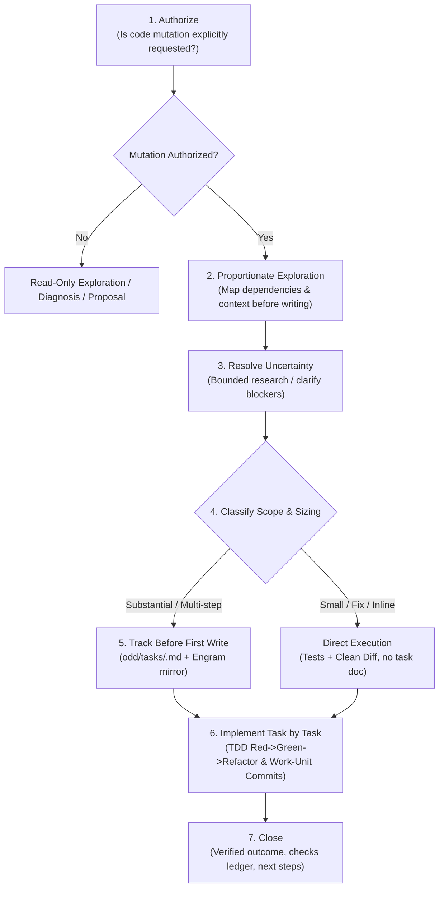

# ODD (Organic-Driven Development) — Canonical Operating Manual

> **Exact Gentle-AI v4.3+ Contract (Gentleman Programming). Replaces legacy Spec-Driven Development (SDD).**

---

## 1. Core Philosophy

**"Keep small work small, manage substantial development dynamically."**

ODD eliminates bureaucratic friction, speculative over-engineering, and rigid upfront documentation by scaling process proportionally to task complexity, risk, and user authorization.

---

## 2. The 7 Canonical ODD Execution Steps



### 1. Authorize
- The agent/developer remains strictly read-only until a code mutation is explicitly requested and authorized.
- Explanations, code investigations, and proposals never mutate files without permission.

### 2. Explore Proportionately
- Always read before write.
- Map existing code paths, helpers, patterns, and dependencies before modifying any code.

### 3. Resolve Uncertainty
- Ask or conduct bounded targeted research only when genuine blockers or ambiguities exist. Never speculate or hedge.

### 4. Classify Sizing
- **Small Work**: Bug fixes, single-module adjustments, or isolated tasks where state can be inferred from the request plus `git diff`. Requires **no durable task file**.
- **Substantial Work**: Multi-step features, architectural changes, or complex integrations. Proceeds to step 5.

### 5. Track Before the First Write
- For substantial work, create:
  ```text
  odd/tasks/<feature-name>.md
  ```
  and immediately mirror the complete document to Engram under topic key:
  ```text
  odd/<feature-name>/tasks
  ```
- **Exact Document Structure (Strict Order)**:
  1. **Header**: 2 or 3 lines naming the feature and context.
  2. `## Specs`: Numbered specifications (`S1`, `S2`, ...) quoting the user's exact strings, errors, and examples **verbatim** (never paraphrased, never adding unrequested requirements).
  3. `## Tasks`: Exactly one line per task formatted as:
     `- [ ] **T1** [S1, S2]: <Task Description> | Route: <inline/worker> | Commit: <sha>`
  4. `## Log`: Last section. `L1` is the user's original request verbatim. Subsequent entries (`L2`, `L3`...) append verbatim user corrections, decisions, and evidence.
  - *Rule*: When a requirement changes, append a verbatim Log entry, rewrite **only** the affected `S#`, and reopen **only** its task.

### 6. Implement Task by Task
- **TDD by Default**: Write the failing test first (`RED`), write the minimal code to pass (`GREEN`), then `REFACTOR`.
- **Observable Effects**: Tests must assert observable effects (exit codes, exact outputs, rejection preserving state) through the public interface.
- **Work-Unit Commits**: Commit in focused slices of **~400 authored changed lines** on dedicated feature branches, pairing behavior with tests and documentation under Conventional Commits. High-risk items get dedicated commits.
- **Check-off Authority**: Check a task checkbox (`[x]`) **only after** its outcome and verification checks have been observed. Update the task file and Engram mirror after each transition.

### 7. Close
- Report the verified outcome, every check (passed, failed, skipped), and the next step.
- Verify through diff analysis that unmentioned shared code has not regressed.
- Pull request creation and merges remain the user's authority.

---

## 3. Canonical Task Template (`odd/tasks/<feature-name>.md`)

```markdown
# Feature: <feature-name>
Tracking document for <feature-name>.
Engram Mirror: odd/<feature-name>/tasks

## Specs
- **S1**: "<Quote user's exact requirement or input verbatim>"
- **S2**: "<Quote expected behavior, boundaries, or constraints verbatim>"

## Tasks
- [ ] **T1** [S1]: Setup test harness and capture RED test state | Route: inline | Commit: -
- [ ] **T2** [S1, S2]: Implement core functionality and verify GREEN state | Route: inline | Commit: -
- [ ] **T3** [S2]: Refactor, document, and verify complete test suite | Route: inline | Commit: -

## Log
- **L1**: "<User's original prompt verbatim>"
```
