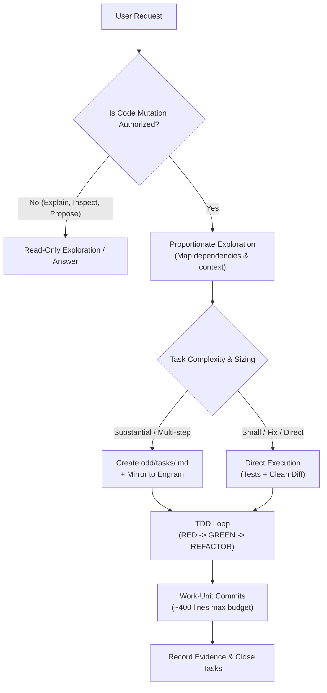

# ODD (Organic-Driven Development) — Operating Manual

> **Based on Gentleman-Programming / Gentle-AI methodology (replacing legacy Spec-Driven Development / SDD).**

---

## 1. Core Philosophy

**"Keep small work small, manage substantial development dynamically."**

ODD eliminates bureaucratic friction, over-engineering, and rigid upfront documentation by scaling process proportionally to task complexity and risk.



---

## 2. The 5 ODD Principles

### 1. Authorization First
- The agent/developer remains strictly read-only until a change is explicitly requested and authorized by the user.
- Exploration must precede mutation: understand existing files, patterns, and dependencies before writing code.

### 2. Keep Small Work Small
- Bug fixes, one-line refactors, or small tasks where risk is contained do **not** require durable task files or heavy planning.
- Small tasks are executed directly with test evidence and minimal diffs.

### 3. Substantial Work Gets a Feature Task File
- For multi-step tasks, new features, or architectural adjustments, initialize a feature tracking file at:
  ```text
  odd/tasks/<feature-name>.md
  ```
- Dual persistence: task lists and decisions are mirrored in **Engram** (`odd/<feature-name>/tasks`) to ensure context survives across sessions, compactions, or agent handoffs.

### 4. Test-First by Default (TDD)
- When a deterministic outcome or test applies:
  1. **RED**: Write and observe the failing test.
  2. **GREEN**: Write minimal code to pass the test.
  3. **REFACTOR**: Polish structure while keeping tests green.

### 5. Work-Unit Commits
- Changes are sliced into clean, reviewable units (~400 changed lines budget).
- Commits must pair implementation with corresponding tests and documentation updates.
- Follow Conventional Commits (`feat:`, `fix:`, `refactor:`, `test:`, `docs:`).

---

## 3. Feature Task Template (`odd/tasks/<feature-name>.md`)

```markdown
# Task: <Feature or Enhancement Name>

## 1. Verbatim Request & Scope
> <Quote the exact user prompt or requirement here>

- **Scope boundaries**: What is included and what is explicitly excluded.

## 2. Design & Assumptions
- Architectural decisions, schemas, or conventions to follow.
- Affected packages, services, or endpoints.

## 3. Tasks & Checklist
- [ ] **Task 1: Exploration & Test Setup**
  - [ ] Write failing test for <behavior>
- [ ] **Task 2: Core Implementation**
  - [ ] Implement <service/component>
- [ ] **Task 3: Verification & Polish**
  - [ ] Ensure 100% tests pass and typechecks are clean
  - [ ] Record execution evidence

## 4. Evidence & Artifacts
- Test run results, terminal outputs, or screenshots.
```
